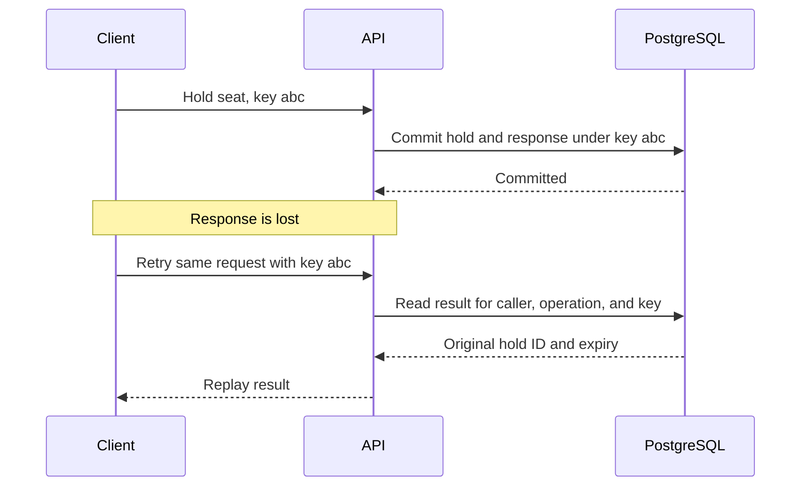

# Retrying a request safely after a timeout

Mid-level · 20 minutes · Pilot draft

## Learning objectives

- Explain what a client knows when a write request times out.
- Design a stable request identifier and a transaction that allows safe retries.
- Explain what changes when the write initiates work in an external system.

## A timeout leaves the outcome unknown

A client sends a request to hold a workshop seat and gets no response before its deadline. The request could have failed before reaching the server. The server could have completed the write and lost the response. The next request needs enough information to distinguish a retry of the same operation from a new decision by the learner.

HTTP defines an idempotent method by its intended effect when repeated. An application can give a specific POST operation an idempotency contract using a client-generated key. Define the scope, payload matching, lifetime, and response behavior in the API contract. Amazon's Builders' Library describes using a client request identifier and coupling its durable record with the mutation. [IETF HTTP Semantics, June 2022](https://www.rfc-editor.org/rfc/rfc9110.html#name-idempotent-methods), [AWS Builders' Library on idempotent APIs](https://aws.amazon.com/builders-library/making-retries-safe-with-idempotent-APIs/)

## Design the retry contract

1. The client generates a key before sending a hold request and reuses it for that operation. Store records by caller, operation, and key. Include a fingerprint of the validated, normalized request. A changed request with the same key returns a conflict.
2. Add a unique constraint on the scoped key. Claim it and create the hold in the same transaction, then record the status and response. When a concurrent duplicate arrives, it waits for the winning transaction and reads the committed result. If the winner rolls back, a later attempt can claim the key again.
3. Choose a retention window long enough for the documented client retry horizon. Return the original hold ID and expiry on replay. A separate read returns the current hold status. Use bounded retries with jitter for transient errors and keep key expiration independent of seat-hold expiration.
4. Give the database a separate invariant for seat ownership. A different customer can have a different key for the same seat. The key deduplicates an operation and the seat's state transition prevents double booking.

This approach gives callers a stable result and makes a committed timeout recoverable. It costs a durable write and retained response data. For a resource whose client can choose its own ID, a PUT to that ID may express the contract more simply. If the operation also sends email, a database transaction can save an outbox message with the hold. The relay and recipient-side system each need a strategy for duplicates. [PostgreSQL transaction isolation](https://www.postgresql.org/docs/current/transaction-iso.html), [Apache Kafka design and delivery semantics](https://kafka.apache.org/design/)

## Interview questions

- A server commits the booking and loses its response. Where can the client recover the result?
- Two different users send hold requests with different idempotency keys for the final seat. What prevents both from succeeding?
- The worker sends a confirmation email and crashes before acknowledging the job. What can the system guarantee when it retries?

## Practical exercise

Implement a hold endpoint with a scoped request key and test it on PostgreSQL. Simulate losing the response after commit and verify that a retry returns the same hold ID. Run two concurrent requests with the same key and verify that at most one hold is created. Then retry the same key with a different seat and check that the request conflicts. Finally, race two different learners for one seat and explain which invariant governs the outcome. The [workshop seat reservation project](../projects/workshop-seat-reservations.md) provides a complete scenario.

## Quiz with answers

1. **Can a timeout establish that the server did not write?** No. It establishes that the client did not receive a result in time. The server might already have committed.
2. **Should an idempotency replay extend the seat hold?** The API above returns the original expiry. Implementing an extension would require a separate operation with its own rules.
3. **Does an outbox guarantee one visible email?** It makes the intent durable alongside the business change. A retry can send the message again unless the recipient or provider deduplicates the delivery.
4. **Why expire request records after the retry horizon?** It controls storage while preserving the documented guarantee. After expiration the client should resolve status through a lookup or initiate an explicitly new operation.

## Further reading

- For HTTP method semantics and retries, read [RFC 9110 section 9.2.2, June 2022](https://www.rfc-editor.org/rfc/rfc9110.html#name-idempotent-methods).
- For client request IDs and late-arriving requests, read [AWS Builders' Library on idempotent APIs](https://aws.amazon.com/builders-library/making-retries-safe-with-idempotent-APIs/).
- For the load impact of retries and how to randomize their timing, read [AWS Builders' Library on retries and jitter, December 2019](https://aws.amazon.com/builders-library/timeouts-retries-and-backoff-with-jitter/).
- For isolation guarantees, read [PostgreSQL transaction isolation](https://www.postgresql.org/docs/current/transaction-iso.html).
