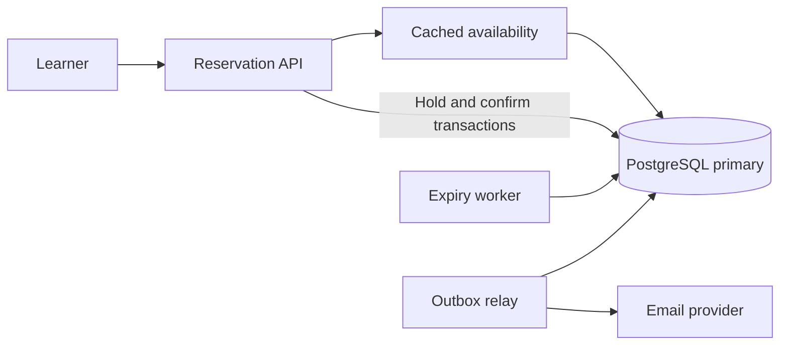

# Workshop seat reservation system

Advanced System Design playlist · Pilot draft

## Problem and requirements

A training marketplace opens enrollment for hands-on workshops. Learners can browse availability, hold a named seat for five minutes, and confirm it. Highly anticipated workshops get most of their requests shortly after enrollment opens. Allow at most one active claim per seat, either a live hold or a confirmed reservation.

- Show workshop details and seat availability. Create a hold on a named seat, confirm it before the deadline, and allow the owner to release an unconfirmed hold. Notify the learner after confirmation.
- Treat availability in browse as advisory and up to five seconds stale. Confirmations and holds use the primary database. A hold or confirmation response targets p95 below 400 ms under the specified test load. Payment and confirmed-reservation cancellation are outside this case.
- Support independent retries of hold, release, and confirm. A replay for a completed action returns its original result. Access to another learner's hold should look the same as access to an unknown hold.

## Capacity estimate

These are exercise assumptions. At 1.2 million browse requests per day, the average is approximately 14 reads/s. A 12× peak implies about 167 reads/s. At 100,000 hold requests and 25,000 confirmations per day, a 20× peak gives roughly 23 hold requests/s and six confirmations/s. Simulate a separate opening burst of 300 attempts/s for one workshop for 30 seconds. Analyze contention on a single popular seat separately from the aggregate workload.

At a planning estimate of 400 bytes per hold record, 100,000 records/day over 30 days require about 1.2 GB of hold payload before indexes, overhead, replication, and backups. Estimate storage for idempotency records and outbox events separately. Measure actual row widths after loading representative data.

## API and data model

| API | Behavior |
| --- | --- |
| GET /workshops/{id}/seats | Returns advisory availability and an as-of timestamp. |
| POST /workshops/{id}/holds | Accepts seat ID and an idempotency key. Returns hold ID and expiry, or 409 if another live hold or confirmation already owns the seat. |
| GET /holds/{id} | Returns current status and expiry to the owner. |
| POST /holds/{id}/confirm | Accepts an idempotency key and confirms an owned, live hold. Returns the existing reservation for an already confirmed hold. |
| POST /holds/{id}/release | Accepts an idempotency key and releases an owned, live hold. Returns an appropriate status for an already expired or confirmed hold. |

| Table | Key fields and constraints |
| --- | --- |
| workshops | Workshop ID, opening time, and metadata. |
| seats | Primary key on workshop ID and seat ID. State, active hold ID, and confirmed reservation ID. Check constraints enforce legal combinations. |
| holds | Hold ID, learner ID, workshop and seat key, status, expiry, and created time. Each active hold matches the seat row it is attached to. |
| reservations | Reservation ID, unique hold ID, unique workshop and seat key, learner ID, and confirmation time. |
| request_results | Unique learner ID, operation, and key. Normalized payload fingerprint, outcome, and retention timestamp. |
| outbox | Unique event ID, reservation ID, delivery status, attempt count, and next attempt time. |

## Architecture

The reservation service makes all write decisions in PostgreSQL. Start by serializing transitions on the seat row. Except for an idempotency replay that can return immediately, operations acquire the seat lock before touching any existing hold, including the expiry worker. After locking, use the current database clock to check expiry so time spent waiting for the lock is reflected in the decision. A new hold transaction can mark an older, expired hold expired and replace it even when the cleanup job is late. The expiry worker skips rows that have changed hold ID and state since selection.

Confirmation checks ownership, the hold token in the seat, and the expiry under that lock. It writes the reservation and the outbox event in the same transaction as the state change and the idempotency result. Releases rely on the same lock and hold-token check, so a late release for an old ID cannot free an already reallocated seat. Unique constraints provide an additional guard against duplicate confirmations. Keep external calls outside these transactions. [PostgreSQL transaction isolation](https://www.postgresql.org/docs/current/transaction-iso.html), [PostgreSQL date and time functions](https://www.postgresql.org/docs/current/functions-datetime.html#FUNCTIONS-DATETIME-CURRENT)

## Scaling, reliability, and trade-offs

Cap concurrent work per workshop and limit repeated requests per learner. Use a cache for the advisory read model and clamp the freshness window to the stated requirement. Reduce lock duration before adding shards. A shard key on workshop ID could separate busy workshops, while requests for one seat still need one authoritative writer. If adjacent multi-seat reservations become a requirement, lock seats in a stable order and update them in one transaction where they share a shard.

Model service and database timeouts separately. On a lost response, replay using the same scoped key. When the primary is unavailable, pause writes and expose a recoverable failure. An asynchronous replica must be promoted only with fencing and a recovery policy that accounts for acknowledged reservations. After an uncertain failover, reconcile before reopening enrollment. Monitor lock waits, rejected requests, double-booking invariants, expiry lag, and outbox age.

The relay sends confirmations with a stable event ID and bounded backoff. The downstream provider may still deliver twice if it cannot deduplicate an accepted send and the relay loses its acknowledgment. Send the same reservation reference on every attempt and keep the account page authoritative for status. [AWS Builders' Library on retries and jitter, December 2019](https://aws.amazon.com/builders-library/timeouts-retries-and-backoff-with-jitter/)

If the database is lightly contended, a conditional update with a version or hold ID predicate can replace explicit row locks. Verify that every path checks the winning update count and persists all required side effects together. A waiting room is an alternative for severe opening bursts. It can bound contention and order admission, at the cost of a queue, a fairness policy, and added user wait.

## Security and costs

Authenticate callers and enforce hold ownership on every read and mutation. Use unpredictable hold IDs, server-side expiry, per-account and per-workshop limits, and parameterized queries. Keep personal contact details out of seat caches, log attributes, and idempotency keys. Restrict expiry and relay identities to the records they need. Track database compute, storage, backups, cache, and notification delivery as separate cost drivers. Use the load test to size a single database before adding cross-region replicas, which add transfer and operational cost.

## Build milestones and validation

1. Implement the schema, browse and hold endpoints, and transactional confirmation using Spring Boot and PostgreSQL.
2. Add release and expiry. Race many clients on the same seat and verify one winner. Race confirmation with expiry, then send the old holder's late release after a new hold has been granted.
3. Inject a timeout after a successful commit and retry with the same key. Verify the same result for concurrent duplicates and a conflict if the payload changes. Recheck ownership using a second account.
4. Add outbox processing, a retry budget, and telemetry. Kill the relay after sending and before it records completion. Observe and explain the delivery behavior.
5. Run the defined aggregate and opening-burst workloads. Record the traffic mix, p95, lock wait, conflict rate, and pending notifications with test settings. Explain how you would admit users or defer work under higher load.

## Interview prompts and rubric

Start with one 25-minute design session. After the baseline, add a workshop opening in two regions or ask the candidate how to allocate several adjacent seats together. For a retry focused on consistency, use only the expiry-versus-confirmation race, then compare the answer against the learner's earlier explanation.

| Dimension | Evidence for a 2 out of 3 |
| --- | --- |
| Requirements | States the ownership invariant and distinguishes five-minute holds from confirmed reservations. |
| API and data | Defines owner-scoped operations, durable retry identity, and a unique seat constraint or equivalent. |
| Architecture | Carries a reservation from request to commit and explains the separation between advisory reads and authoritative state. |
| Scale and reliability | Quantifies peak load, explains single-seat contention, and addresses a lost response or partial failure. |
| Trade-offs and communication | Compares viable alternatives against the same constraints and explains an operational consequence. |

Use 0 for missing or materially incorrect reasoning, 1 for partial coverage, 2 for the behavior above, and 3 for behavior justified under an added constraint. Record one excerpt or missing requirement per dimension. Recommend the [lesson on retries](../lessons/idempotent-retries.md) when the learner conflates a lost response with a failed write.
