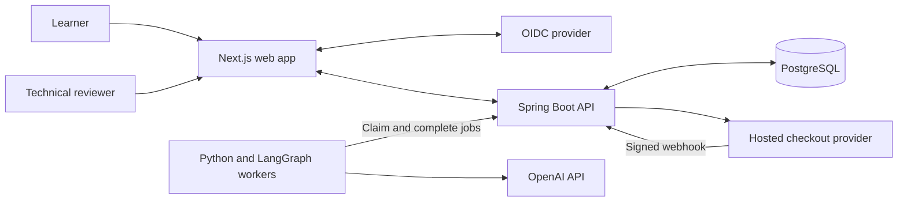

# MVP specification for SystemDesign Academy AI

The first paid release gives mid-level backend candidates a structured practice path, an original project library, and guided feedback they can act on in another attempt. The first delivery milestone tests the practice loop with an editor and a technical reviewer. Subscription billing and automated scoring follow once the curriculum and rubric work with real learners.

## Learner flow and acceptance criteria

| Capability | First release behavior | Acceptance criteria |
| --- | --- | --- |
| Account and onboarding | Sign in through an OAuth/OIDC provider. Set experience level, interview date, and weekly time budget. | A learner can sign in on another device and recover their path and progress. The server derives the current learner from the session. A second account cannot read or mutate the first account's records. |
| Path, lessons, and quizzes | Show an ordered path, prerequisites, lesson citations, quiz feedback, and the next recommended step. | A free learner can complete the ten public lessons and see which items require Pro. A quiz result retains the lesson and question revisions used. Retrying a progress write does not create duplicate completions. |
| Guided design | Attempt a case with a structured answer and an editable component diagram. Save and resume. | Notes and diagrams restore after refresh. The learner can use a keyboard-accessible component and connection list. Stale saves return a conflict and preserve the newer draft and the learner's unsaved copy. Worked solutions stay hidden until the learner chooses to reveal them. |
| Feedback and retry | Score five rubric dimensions, assign a weak-skill lesson, and provide a comparable variant or changed constraint. | Each score cites an answer excerpt or describes a missing requirement. Scores and links refer to the case version used. A retry comparison shows evidence from both attempts and links to the relevant lesson. The phase 2 pilot accepts reviewer-authored reports. |
| Subscription | Show the local price, renewal date, and usage limits. Support checkout, cancellation, and access through the paid-through time. | A confirmed provider event grants access. Duplicate, delayed, invalid-signature, and reversed-order events preserve correct access. Cancellation and failed renewal are visible in account settings. Paid-only API routes enforce the same entitlements as pages. |
| Content operations | Review, preview, publish, and roll back versioned lessons, cases, rubrics, and sources. | Draft content is invisible to learner routes. A publisher can restore an earlier published revision. Existing attempts and score reports remain readable against the versions recorded at submission. |

A learner's design notes and answers are private by default. Collect the fields needed to teach and track progress. Retain full answers and diagrams for 90 days by default during the pilot and retain scores and completion after that window. Explain the window before submission. Provide account export and deletion, and scope all learners' practice data by account on the server. Confirm the retention policy with pilot users and review billing records against applicable retention obligations.

Pilot scope is English and responsive web, with original text and diagrams. Voice interviews, public sharing, video production, team plans, and the broader 100+ problem catalog follow demonstrated learner demand. Differentiate coached practice and timed assessment in the UI so learners know when hints are available.

## System architecture

Next.js and TypeScript serve the learner and reviewer interfaces. Use Auth.js with OIDC for authentication and server-side session forwarding. Forward a short-lived, audience-bound identity assertion to Spring Boot and validate the issuer, signature, audience, expiration, and stable subject there. Spring Boot owns curriculum, progress, practice, billing, and audit records. A database-backed queue lets the API save an attempt and enqueue evaluation in one transaction. A scoped worker credential can claim and finish only permitted jobs. The API builds the authorized input snapshot for each job.

Start with PostgreSQL for relational and versioned content, search by topic metadata, and serialized diagram graphs. Use pgvector when a retrieval evaluation shows that embeddings improve coverage over metadata and full-text retrieval. Introduce Redis if shared rate limiting or measured cache pressure warrants it. Add private S3 storage when learner exports or reviewed media require files. Use Docker for local setup and a single-region AWS deployment with managed PostgreSQL and containers for the first paid release. Instrument request and job traces with OpenTelemetry.

A recurring subscription uses one hosted provider initially. Evaluate Stripe and Razorpay against merchant eligibility, currencies, recurring payment support, settlement, and cancellation needs for the first cohort. Use stable provider event and subscription IDs to deduplicate and reconcile in PostgreSQL. Store a signature-verified event durably before acknowledging. Serialize updates per provider subscription and fetch its current state for stale or ambiguous events before deriving entitlement. A scheduled reconciler checks payments whose processing failed or whose event sequence is incomplete.

### Core records

| Data | Key fields and ownership |
| --- | --- |
| Users and profiles | User ID, identity issuer and subject, target level, interview date, and study budget. |
| Curriculum | Stable content ID, immutable revision ID, prerequisite IDs, source records, reviewer status, and published pointer. |
| Practice | Attempt owner ID, case and rubric revisions, draft version, cloned-from attempt ID, diagram, submitted answer, submission time, and status. |
| Scores and recommendations | Attempt ID, reviewer or model version, evidence by dimension, total, lesson link, retry constraint, and review state. |
| Billing | Account ID, provider customer and subscription IDs, plan, period bounds, status, deduplicated events, and reconciliation state. |
| Usage | Account ID, allowance window, feature, request ID, units reserved, units committed, and job state. |

Initial API surface includes paths and lessons, lesson progress and quiz submissions, practice draft and submission, score retrieval, entitlements, checkout, and signed billing webhooks. Use revision checks for draft saves. Practice submission carries an idempotency key scoped to the learner and attempt. Retrying with the same key and payload returns the original submission. A changed payload with the same key yields a conflict. Job claims have a lease and a unique execution ID. Finalization checks the live lease and commits the report and the matching usage reservation together. Renew leases during long calls, bound retry attempts, and surface failures so the learner can recover.

## AI and editorial workflow

| Role | Inputs and outputs |
| --- | --- |
| Orchestrator | Maps an editorial request or learner event to an authorized workflow, sets a token and time budget, and tracks completion. |
| Research | Collects primary evidence and creates a dated, versioned claim record with sections and corroboration. |
| Curriculum | Maps prerequisites, objectives, and assessment checkpoints to levels and playlists. |
| Lesson and project generation | Produces structured drafts using the approved evidence and original case templates. |
| Architecture | Emits a typed component-and-edge graph, checks edge references, and explains alternatives under the selected scenario. |
| Interview | Maintains the session phase and time budget, asks one question at a time, and introduces one constraint. |
| Evaluation | Returns validated rubric scores, excerpts or missing evidence, a remediation lesson, and a retry constraint. |
| Quality assurance | Checks citations, numerical assumptions, diagrams, factual claims, and scoring calibration. A technical reviewer approves published changes. |

In phase 1 use the Business workspace agent for internal research and drafting. For the customer product, use Python and LangGraph for generation and evaluation when those features ship. Treat retrieved content and candidate answers as text inputs. Keep interviews and scoring within their job-specific tool and data access. Validate structured outputs and confirm citations and quoted excerpts against stored sources and the submitted answer. Unusable output goes to reviewer fallback or a visible failed state. Track provider failures, timeouts, token spend, and the time to complete a queued evaluation.

Score five dimensions from 0–3. A 0 means missing or materially incorrect, 1 means partially addressed, 2 means sound under baseline assumptions, and 3 means justified with trade-offs and a changed constraint. Report individual dimensions and the sum out of 15 for the same rubric revision. Accept equivalent technologies where they preserve the required guarantees.

Use a golden set of 30 reviewed answers across strong, partial, and weak responses. Include an alternate valid architecture, a superficially plausible answer that violates an invariant, and a response containing instructions to ignore the rubric. Before automated reports, require at least 85% of dimension scores to fall within one point of human consensus, no failing safety-critical invariant to be presented as sound, and every quoted excerpt to match the input. Define the consensus workflow with two reviewers and adjudicate disagreements. Re-run the set for model, prompt, or rubric changes and inspect labeled failures.

## Business and operating targets

The paid pilot uses Free and Pro with published, server-enforced quotas. An initial Pro ceiling of 25 tutor requests and six text mocks per month is a hypothesis. Reserve quota at request acceptance, commit it on successful delivery, and release unsuccessful reservations. Limit transcript length, output tokens, and model attempts for each workflow. Track costs even when a provider charges for work with no deliverable, and stop admitting new AI jobs when a configured spend cap is reached.

A planning example using GPT-5.4 mini at $0.75 per million input tokens and $4.50 per million output tokens assumes 1,200 input and 450 output tokens per tutor request and 24,000 total input and 5,000 total output tokens per mock, including evaluation. At full use, estimated model text cost is $0.073 for 25 tutor requests plus $0.243 for six mocks, or about $0.32 per paying account per month. Measure actual usage and provider charges. Hosting, retries, embeddings, tools, taxes, support, payment fees, and voice require separate budgets. [OpenAI API model pricing](https://developers.openai.com/api/docs/models/gpt-5.4-mini)

Track onboarding-to-first-attempt completion, first-week retries, target dimension improvement, paid conversion, retention, and AI spend per active paid account. Record cohort and market with denominators. Pilot operating targets include 99.5% read-route availability over a month, p95 under 500 ms for lesson and progress API reads at the agreed pilot workload, and a p95 under 60 seconds for text evaluation after successful submission. Set a workload profile before testing. Back up the database daily, test restoring it in staging, and record recovery time and point achieved. Establish alerts for webhook lag, growing evaluation queues, and rising per-report cost.

## Delivery phases

| Phase | Deliverables and implementation steps | Acceptance criteria | Unresolved decisions |
| --- | --- | --- | --- |
| 1. Research and content engine | Configure and preview the internal agent. Capture a source registry and versioned topic map. Draft and review six lessons, two design problems, and the baseline rubric. Run an editor-assisted pilot. | Every pilot item passes source and technical review. Two reviewers can score the same sample independently. Pilot participation, retries, and paired improvement are measured. | Technical reviewer, recruitment channels, source refresh cadence, and exact paired variants. |
| 2. SaaS MVP | Build auth, path and quiz pages, project viewer, guided design editor, progress, reviewer feedback, and staged subscription checkout. Expand to 16 lessons, eight guided cases and three projects. | A new learner can purchase, do a design, receive a review, retry, and see the comparison. Account isolation, navigation, billing replay, and staging restore pass end to end. | Merchant and provider selection, localization, retention, and checkout price. |
| 3. AI tutor and interview | Add retrieval and grounded tutoring, diagram support, project drafting, text mocks, and automated scoring with reviewer fallback. | Scoring meets the golden-set gate. Quotas, timeout handling, citation checks, and per-report costs are measured in staging and a limited release. | Model routing, escalation policy, and whether a separate voice pilot is warranted. |
| 4. Advanced preparation | Add adaptive paths, senior and staff tracks, deeper build projects, and function-specific preparation. | New tracks have measurable checkpoints. Recommendations improve completion or retry outcomes in a cohort comparison. | Which tracks have enough demand, what community features support them, and company-specific sourcing policy. |
| 5. Paid launch | Roll out in stages, verify checkout and cancellation, monitor learner and cost metrics, and address feedback. | Restore and support drills pass, spend and billing metrics are visible, and the paid cohort can complete the practice loop from onboarding to renewal or cancellation. | Annual and team plans, acquisition budget, regional expansion, and support commitments. |
